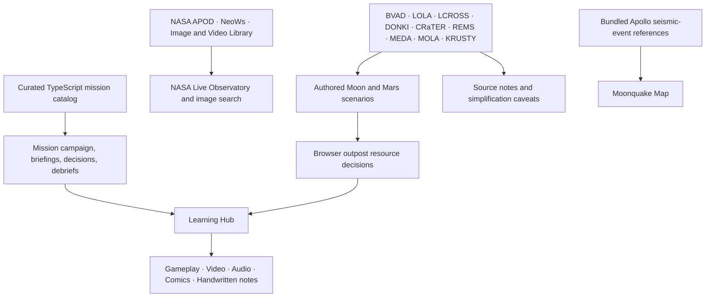

# Jr_AstroCamp — Browser Product Roadmap

**NASA International Space Apps Challenge 2026 · Team Mysterio**

## Current browser experience

Jr_AstroCamp makes mission decisions the starting point for space STEM learning. It combines a historical mission campaign, interactive browser simulators, four curated Moon and Mars survival scenarios, and five learning formats: gameplay, video, audio, comics, and handwritten-style notes.

The campaign's 76 mission profiles are curated historical summaries. NASA references inform selected scenario concepts, while public NASA APIs provide separate live context for APOD, NeoWs, and image search. Most game values are simplified for education, not raw telemetry or live hazard feeds. The Apollo Moonquake Map plots bundled seismic-event references and uses an illustrative waveform.

## Browser architecture

The app is built with React, TypeScript, Vite, and Three.js. The CapCom helper uses local response rules and authored science notes; student questions are not sent to an external AI service.

## Roadmap

### Current: judging-ready browser demo

- Verify the campaign briefing → decision → debrief flow.
- Demonstrate one of the four survival scenarios and all five learning options.
- Keep NASA live feeds separate from simplified scenario references.
- Clearly label the Moonquake waveform as illustrative.

### Next: classroom pilot

- Pilot the experience with teachers and students.
- Improve mission feedback and make consequences easier to understand.
- Improve classroom accessibility and navigation across desktop and mobile screens.
- Gather teacher feedback before expanding account or classroom features.

### Future: classroom expansion

- Explore teacher-assigned mission sets and classroom progress views.
- Evaluate learning outcomes with pilot partners.
- Add mission content only with documented references and clear distinctions between live data, archived data, and simplified educational scenarios.

## Team

| Role | Contribution |
| --- | --- |
| AI Automation Engineer | Automation and project tooling |
| Data Scientist | Mission and scenario data |
| ML Engineer | Data-informed analysis and feedback |
| Full-Stack Developer | Browser app and interactive experiences |
| Researcher | NASA source research and science review |
| UI/UX Designer | Learning experience and interface design |
