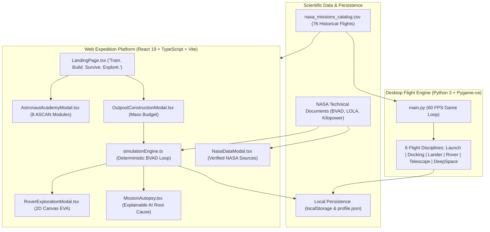

# 🚀 Jr_AstroCamp: Beyond Earth
### *“Train. Build. Survive. Explore.”*

**NASA International Space Apps Challenge 2026**  
**Official Challenge:** [Build a Junior Astronaut Mission Trainer](https://www.spaceappschallenge.org/2026/challenges/build-a-junior-astronaut-mission-trainer/)  
**Team Mysterio**

[](https://react.dev)
[](https://www.pygame.org)
[](https://vitejs.dev)
[](./docs/TESTING.md)
[](./docs/SCIENCE_AND_DATA_SOURCES.md)
[](#-for-competition-judges-1-click-instant-demo-mode)

## GitHub Pages Deployment

The `.github/workflows/deploy-pages.yml` workflow builds the app on pushes to `main` and deploys `dist`. A repository admin must set **Settings → Pages → Build and deployment → Source** to **GitHub Actions** before the workflow can publish. The Vite base path is configured for this repository's Pages URL.

---

## 🏆 For Competition Judges: 1-Click Instant Demo Mode

Judges have limited evaluation time! We built a dedicated **Judge Bypass & Instant Demo Gateway** accessible right on the Landing Page and Top Navigation (`🏆 Space Apps Judge Preview`):

- **✨ 1-Click Complete Unlock:** Instantly unlocks **999,999 Cadet Credits**, all **76 Historical NASA Missions**, and all **8 ASCAN Academy Badges** without grinding.
- **🛰️ Interactive 3D Equipment Depot:** Inspect high-fidelity NASA 3D hardware (ACES Suit, Apollo Lunar Module, Artemis Gateway Core, Deep Space Communications Dish).
- **📡 Live NASA Telemetry Pipeline:** Toggle real-time scientific data feeds, mathematical formulas, and official dataset citations (NASA BVAD-2015, LOLA GDR, Kilopower KRUSTY).
- **📜 NASA Flight Certificate Generator:** Produce authentic, printable Vector/Canvas astronaut graduation certificates complete with cadet callsign, fuel efficiency, gold astronaut wings, and NASA challenge verification stamp.
- **👩‍🏫 Dual-Role Authentication:** Real student cadet accounts and verified teacher accounts (`@school.edu`) with a live Junior Astronaut Classroom Roster.

---

## 🌟 1. Executive Summary & Problem Statement

> *"In a universe where the next generation of astronauts is sitting in classrooms right now, Jr_AstroCamp is our answer to the question every space agency asks: How do you turn a curious kid into a mission-ready thinker?"*

Most educational space software either reduces authentic space science to decorative cartoons with no genuine stakes, or buries young minds in dry, non-interactive encyclopedias.

**Jr_AstroCamp: Beyond Earth** transforms learning into a high-stakes, authentic aerospace expedition. Grounded in real NASA engineering data from the **Artemis program**, **Lunar Reconnaissance Orbiter (LRO)**, and **Mars Science Laboratory (MSL)**, cadets don't simply read about space—they **train**, **budget limited rocket cargo**, **command human life support systems**, **dodge lunar night power crises**, **drive scientific rovers**, and **experience the real chain-reaction consequences of every engineering trade-off.**

The project features a **unified dual-engine architecture**:
1. **Interactive Web Expedition Simulator (React 19 + TypeScript + Three.js + HTML5 Canvas):** A full turn-based planetary base builder, cargo allocator, rover simulation, and 8-lesson Astronaut Academy.
2. **Desktop 60 FPS Flight Simulator (Python 3 + Pygame-ce):** A high-performance flight physics engine with 76 cataloged historical NASA missions across 6 flight disciplines (Launch, Docking, Lunar Landing, Rover Traverse, Space Telescope, Deep Space Slingshot).

---

## 👥 2. Team Mysterio & Roles

| Role | Name / Placeholder | Key Contribution |
| :--- | :--- | :--- |
| **Full-Stack & Systems Engineer** | *[Team Member Name]* | Web expedition architecture, simulation engine, state machine, and test runner |
| **Game & Simulation Developer** | *[Team Member Name]* | Pygame 60 FPS flight engine, rover canvas physics, and 3D lunar rendering |
| **Aerospace Data Researcher** | *[Team Member Name]* | BVAD life-support stoichiometry, LOLA topography, and Kilopower reactor integration |
| **UI/UX & Instructional Designer** | *[Team Member Name]* | Astronaut Academy curriculum, comic storyboards, audio synthesis, and HUD design |
| **QA & Verification Engineer** | *[Team Member Name]* | Automated unit tests, deterministic simulation assertions, and cross-platform verification |

---

## 🎮 3. Complete Feature Tour

### 🎓 1. Astronaut Academy (8 Interactive ASCAN Modules)
A guided, interactive astronaut training sequence aligned with NASA human exploration protocols:
- **Module 1: Airlock & Depressurization Safety:** Atmospheric pressure differentials ($\Delta P$) and 100% O2 pre-breathe to prevent decompression sickness.
- **Module 2: ECLSS & Sabatier Reactions:** Carbon dioxide scrubbing and chemical catalytic reaction: $\text{CO}_2 + 4\text{H}_2 \rightarrow \text{CH}_4 + 2\text{H}_2\text{O}$.
- **Module 3: Power: Photovoltaics vs Fission:** Sun-tracking solar mast angles vs continuous 24/7 Kilopower nuclear Stirling generation during the 354-hour lunar night.
- **Module 4: Potable Water Recycling:** Vacuum distillation vs thermoelectric membrane loops recovering up to 98% of human moisture.
- **Module 5: Hydroponic Biomass & Nutrition:** Dual-spectrum 450nm/660nm LED salad pods, plant transpiration, and psychological crew benefits.
- **Module 6: Space Radiation & Regolith Shielding:** Galactic Cosmic Rays (GCR), Solar Particle Events (SPE), ALARA guidelines, and 1.5m sintered regolith storm vaults.
- **Module 7: Rover Traction & Terramechanics:** Regolith wheel-slip ratio, steering geometry, slope limits, and radar navigation.
- **Module 8: Cryogenic Core Sample Collection:** Raman spectroscopy and identifying sub-surface water ice in permanently shadowed polar craters (<40 K).

### 🚀 2. Mission Selection
- **Lunar Expedition (Shackleton Polar Base):** 30-Sol primary mission at the lunar South Pole. Features the extreme 354-hour lunar night and cryogenic cold traps.
- **Martian Outpost (Jezero Crater):** 40-Sol deep-space mission featuring atmospheric dust storm opacity ($\tau$), thin 610 Pa atmosphere, and longer telemetry communication delays.

### 🏗️ 3. Outpost Construction & Cargo Budget
Cadets are allocated a strict launch mass limit on the heavy-lift booster:
- **Lunar Mass Budget:** `45,000 kg` | **Mars Mass Budget:** `60,000 kg`
- Choose across 10 critical systems: Habitat, Power Generation, Energy Storage, Life Support, Water Recycling, Greenhouse, Radiation Shielding, Communications, Maintenance, and Surface Rover.
- **Real Trade-Offs:** Selecting heavy high-tech gear (e.g. Kilopower Reactor + Heavy Dome + Sabatier + Full Biome) exceeds the 45,000 kg rocket limit and **locks the launch button**, forcing cadets to balance mass vs capability.

### 🕹️ 4. Mission Control: Core Turn-Based Simulation
- **Authoritative Deterministic Physics:** Based on the NASA BVAD human metabolic baseline ($0.84\text{ kg O}_2$, $2.50\text{ kg H}_2\text{O}$ per crew-day).
- **Diurnal Day/Night Cycle:** Solar arrays generate 0 kW during the 354-hour lunar night (Sols 16–27). If batteries deplete to 0%, habitat heaters freeze, triggering critical failure.
- **Shift Directives:** *Standard Operations*, *Power Conservation* (cuts base electrical load by 40%), *Science Intensive* (+10 science yield at high power cost), *ECLSS Overhaul*, *Greenhouse Surge*, and *Rover EVA*.

### 📰 5. Mission Events & Branching Decisions
- Realistic, unscripted operational events: *Coronal Mass Ejections (CME)*, *Regolith Dust Abrasions*, *Water Recovery Membrane Leaks*, *Hydroponic Root Blight*, and *Cryogenic Ice Discoveries*.
- Comic storyboard panels illustrate the situation with multi-character dialogue (Cadet Maya, Commander Dadu, Houston CapCom).
- Each response option has explicit mathematical consequences on life-support reserves.

### 🚙 6. Playable Surface Rover Exploration (EVA Minigame)
- Top-down 2D canvas physics simulation with keyboard (`WASD`/Arrows) and mobile on-screen controls.
- Dynamic wheel tracks, crater terrain hazards, high-relief boulders, battery consumption, and a real-time radar waypoint compass pointing toward volatile ice hotspots.
- Drill core samples to collect Science Research Points and return safely to base before battery exhaustion.

### 🔬 7. Science Learning Hub & NASA Datasets
- 6 comprehensive domains documenting real NASA baseline datasets (BVAD, LOLA, Kilopower, CRaTER, REMS, NSSDC).
- Explicit `[REAL NASA DATA]` vs `[GAME SIMULATION VALUE]` labeling for complete scientific transparency.

### 📊 8. Mission Autopsy & Debrief
- Evaluates mission outcome (`VICTORY`, `PARTIAL_SUCCESS`, or `CRITICAL_FAILURE`).
- **Explainable AI Root-Cause Tree:** Details the exact cascading chain of events that led to mission success or failure.
- Actionable NASA engineering recommendations for the cadet's next attempt.

---

## 🛠️ 4. Architecture & Technology Stack



---

## 🚀 5. Installation & Quick Start

### Prerequisites
- **Node.js:** v18+ (v20+ recommended)
- **Python:** v3.10+ (for Pygame desktop flight engine)

---

### Option A: Launch the Web Expedition (Primary Platform)
```bash
# 1. Clone repository
git clone https://github.com/meetmehedi/Jr_AstroCamp.git
cd Jr_AstroCamp

# 2. Install Node dependencies
npm install

# 3. Run automated simulation test suite (8 assertions)
npm test

# 4. Start local development server
npm run dev
```
Open **[http://localhost:5173](http://localhost:5173)** in your browser.

To verify production bundle compilation:
```bash
npm run build
```

---

### Option B: Launch the Desktop Flight Simulator (Pygame)
```bash
# 1. Install Python dependencies
pip install -r requirements.txt

# 2. Run automated headless test suite
python tests/test_game.py

# 3. Launch 60 FPS Desktop Flight Simulator
python main.py
```

---

## ⏱️ 6. 3-to-5 Minute Demonstration Walkthrough Script

Follow this script to demonstrate Jr_AstroCamp to competition judges in under 5 minutes:

| Time | Step / Feature | Screen / Action | Talking Point |
| :---: | :--- | :--- | :--- |
| **0:00 - 0:45** | **Introduction & Mission Vision** | Main Menu (`LandingPage.tsx`) | *"Welcome to Jr_AstroCamp: Beyond Earth. Built for the 2026 NASA Space Apps Challenge, this is a real playable educational space simulator. Notice our core philosophy: Train, Build, Survive, Explore."* |
| **0:45 - 1:30** | **Astronaut Academy** | Click **"Astronaut Academy"** | *"Before commanding a base, cadets train across 8 ASCAN modules grounded in NASA protocols—from Sabatier chemistry to lunar regolith radiation shielding, complete with interactive mini-widgets and quizzes."* |
| **1:30 - 2:30** | **Outpost Cargo Budgeting** | Click **"Start Mission"** -> Cargo Allocator | *"Unlike casual games with infinite resources, here we face a real 45,000 kg rocket cargo budget. If I choose high-end nuclear reactors and heavy domes, my budget overflows and locks the launch. Every system requires real trade-offs."* |
| **2:30 - 3:30** | **Mission Control & Lunar Night** | Confirm launch -> Sol 1 Mission Control | *"Now at Sol 1. Our simulation engine models authentic NASA BVAD human metabolic consumption. During the 354-hour lunar night, solar generation drops to zero. Cadets must manage battery reserves and shift actions to survive."* |
| **3:30 - 4:15** | **Rover EVA Minigame** | Click **"ROVER EVA"** button | *"Cadets can deploy the surface rover into permanently shadowed craters. Using radar guidance and battery management, we drive over hazards, drill cryogenic ice cores, and return science points to base."* |
| **4:15 - 5:00** | **NASA Science Data & Debrief** | Click **"NASA Data"** -> View Debrief | *"Every single simulation value is labeled either [REAL NASA DATA] or [GAME SIMULATION VALUE], citing official documents like BVAD and LOLA. The Mission Autopsy provides an Explainable AI root-cause analysis showing why decisions succeeded or failed."* |

---

## 🔬 7. Verified NASA Science Data Attribution

All scientific baselines in Jr_AstroCamp cite verified, publicly accessible NASA technical publications:

| Domain | NASA Technical Publication / Dataset | Direct Source URL | Game Mechanics Application |
| :--- | :--- | :--- | :--- |
| **Life Support (ECLSS)** | *Baseline Values and Assumptions Document (BVAD)* (NASA/TP-2015-218570) | [NASA NTRS](https://ntrs.nasa.gov/citations/20150002905) | Daily crew metabolic consumption: 0.84 kg O2, 2.50 kg water, 0.62 kg dry food per crew-day. |
| **Lunar Lighting & Topography** | *Lunar Reconnaissance Orbiter (LRO) LOLA Science Team* | [LRO LOLA](https://lola.gsfc.nasa.gov/) | Shackleton crater rim polar lighting (>80% solar illumination) vs permanent shadow cold traps (<40 K). |
| **Fission Surface Power** | *Kilopower Reactor Using Stirling Technology (KRUSTY)* (NASA Glenn / LANL) | [NASA STMD Kilopower](https://www.nasa.gov/directorates/stmd/game-changing-development-program/kilopower/) | Continuous 10 kWe / 25 kW baseline fission power independent of lunar night or solar dust occlusion. |
| **Cosmic Radiation** | *Cosmic Ray Telescope for the Effects of Radiation (CRaTER)* | [LRO CRaTER](https://crater.unh.edu/) | Deep-space GCR exposure rates (0.5 mSv/day) and 1.5m sintered regolith shielding attenuation. |
| **Martian Atmosphere** | *Curiosity Rover Rover Environmental Monitoring Station (REMS)* | [NASA JPL MSL REMS](https://mars.nasa.gov/msl/spacecraft/instruments/rems/) | Thin surface pressure (610 Pa), diurnal thermal swings, and atmospheric dust opacity ($\tau$). |
| **Historical Flight Archive** | *NASA Master Catalog & National Space Science Data Center* | [NASA NSSDC](https://nssdc.gsfc.nasa.gov/) | 76 authentic historical mission flight parameters across Mercury, Apollo, Skylab, Shuttle, and Artemis. |

*For complete data tables, stoichiometry, and units, see [docs/SCIENCE_AND_DATA_SOURCES.md](./docs/SCIENCE_AND_DATA_SOURCES.md).*

---

## 🧪 8. Automated Testing & Verification

Jr_AstroCamp includes comprehensive automated test suites:
- **`npm test`**: Runs `tests/test_simulation.mjs` verifying initial state, mass budget capping, day/night transitions, Kilopower night generation, shift actions, battery failure detection, victory conditions, and resource clamping (8/8 pass).
- **`npm run build`**: Runs `tsc -b` and `vite build` verifying zero TypeScript type errors across 1,935 modules.
- **`python tests/test_game.py`**: Headless automated test suite verifying 76 flight missions, procedural sound synthesis, 6 simulation scenes, and save progression (100% pass).

*For full testing logs and protocols, see [docs/TESTING.md](./docs/TESTING.md).*

---

## 🎨 9. Asset Credits & Licensing

- **3D Spacecraft & Suit Models:** Official NASA 3D Resources ([NASA 3D Resources](https://nasa3d.arc.nasa.gov/)) — ACES suit, Lunar Module, Astronaut, Dish Antenna, Gateway Core. Public domain under NASA Media Usage Guidelines.
- **Iconography:** Lucide Icons (ISC License).
- **Audio Synthesizer:** Custom procedural Web Audio API & Pygame wave synthesis (zero external audio dependency, 100% offline).
- **Planetary Textures & Elevation:** NASA Scientific Visualization Studio (SVS) & USGS Astrogeology Science Center.

---

## ⚠️ 10. Known Limitations & Compatibility

- **Device Support:** Fully responsive across desktop, laptop, Chromebook, tablet, and mobile.
- **3D Graphics Fallback:** A toggle in Settings (`SettingsModal.tsx`) switches between WebGL Three.js rendering and an optimized 2D schematic HUD for ultra-low-power student laptops.
- **Offline First:** 100% playable offline without internet connectivity.

---

*(c) 2026 Team Mysterio · Jr_AstroCamp: Beyond Earth · NASA Space Apps Challenge 2026*
