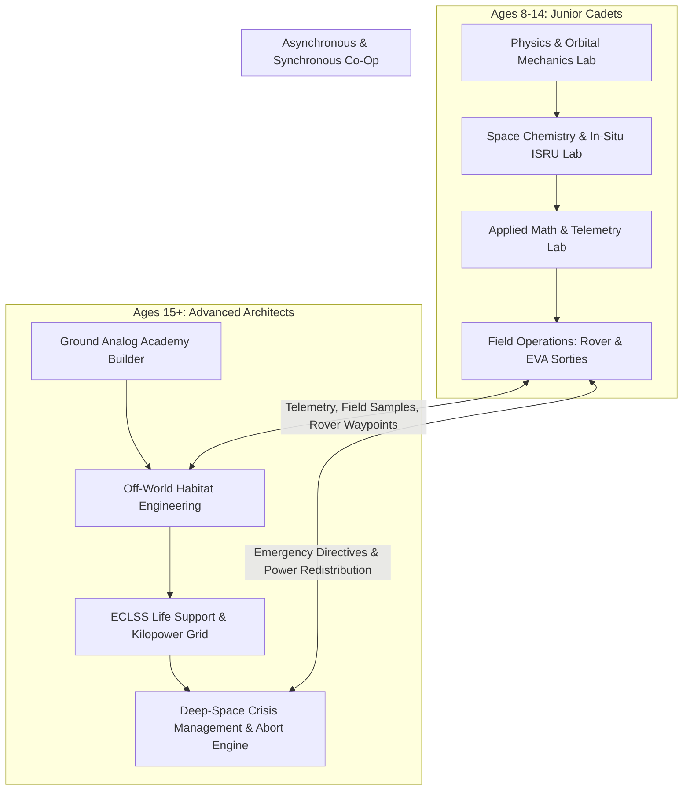

# Junior Astrocamp: From Ground Trainee to Deep-Space Habitat Architect
## Executive Game Design & STEM Curriculum Document (GDD)
**NASA International Space Apps Challenge 2026**  
**Track:** Build a Junior Astronaut Mission Trainer  
**Project:** Jr_AstroCamp (Beyond Earth)  
**Authors:** Team Mysterio (Lead Educational Game Architect & NASA Systems Engineering Core)

---

### Open-Source Architecture & NASA Open Asset Integration

This platform synthesizes state-of-the-art open-source WebGL frameworks and official NASA engineering resources:
1. **Telemetry & Tactical Instrument UI:** Real-time orbital telemetry, instrument clusters, and glassmorphism HUD inspired by [`fluxforgeai/ARTEMIS`](https://github.com/fluxforgeai/ARTEMIS) and [`msakuta/WebGL-Orbiter`](https://github.com/msakuta/WebGL-Orbiter).
2. **Photorealistic Lunar/Martian Terrain:** NASA JPL Cesium-ion 3D tile streaming using [`NASA-AMMOS/3DTilesRendererJS`](https://github.com/NASA-AMMOS/3DTilesRendererJS) with LOLA Lunar Orbiter Laser Altimeter elevation data and Apollo seismic markers from [`ConstantinosAr/Moonquake-Map`](https://github.com/ConstantinosAr/Moonquake-Map).
3. **Official NASA 3D Models:** Direct integration of NASA's raw assets from the [NASA 3D Resources Portal](https://nasa3d.arc.nasa.gov/models) (Artemis xEMU Suit, VIPER Rover, Gateway Core, Perseverance, Habitat Demonstration Units) via Three.js `GLTFLoader`.

---

---

## 1. The "Junior Astrocamp" Progression System

### 1.1 Rank & Certification Pipeline

Progression in *Junior Astrocamp* mirrors the real qualification timeline of NASA’s Astronaut Candidate (ASCAN) program, transitioning from individual tactical problem solving to multi-crew habitat governance:

| Tier / Rank | STEM Competency Target | Unlocked System Access | Clearance Criteria |
| :--- | :--- | :--- | :--- |
| **1. Trainee Cadet** (Ages 8–10) | Newtonian gravity, air drag, basic atmospheric states | Vacuum drop chamber, 1-axis rocket test bench | 3 Basic STEM Labs + 1 Rover Sortie |
| **2. Mission Specialist** (Ages 11–14) | Electrolysis, Sabatier loops, orbital vector docking | Lunar EVA suit, VIPER drill, Gateway airlock | 5 Applied Labs + Sol 1–10 Survival |
| **3. Flight Commander** (Ages 15–17) | Delta-V budgeting, Hohmann transfer, solar storm alerts | Multi-Crew Co-Op Bridge, Manual Skycrane EDL | Complete Campaign + Co-Op Cert |
| **4. Camp Architect** (Ages 18+ / Univ) | Closed-loop ECLSS math, ISRU regolith sintering, Kilopower reactor kinetics | Full 3D Base Builder, Kilopower Nuclear Grid, Mission Control Terminal | Sol 30 Off-World Self-Sustaining Colony Benchmark |

### 1.2 Core Gameplay Loop
1. **Learn by Doing (Interactive 3D Micro-Labs):** Cadets do not read paragraphs; they toggle physical valves, adjust reactor control rods, fire RCS thrusters, and observe real mathematical outputs.
2. **Earn Spaceflight Clearances:** Completing labs yields digitally signed NASA Flight Certifications with cryptographic telemetry logs (exportable for classrooms and portfolios).
3. **Deploy & Manage Habitats:** Certified resources and equipment unlocked in labs can then be allocated inside the 3D Habitat Builder.

### 1.3 Dynamic Cross-Generation Co-Op Architecture
The platform bridges age brackets through a **Dual-Station Command Matrix**:
* **The Junior Cadet (Field Operator):** Plays in real-time 3D (first/third-person EVA or rover cockpit). They drive into Shackleton Crater’s Permanently Shadowed Regions (PSR), collect core samples with a neutron spectrometer, and patch micrometeorite breaches on the hull.
* **The Advanced Architect (Flight Director / EECOM):** Operates the 2D/3D Tactical Telemetry Bridge. They monitor life-support consumables, route emergency power from Kilopower reactors to the airlock, calculate communications latency windows through NASA's Deep Space Network (DSN), and guide the Cadet via voice and vector waypoints.
* **Failure Interdependence:** If the Cadet punctures an oxygen line, the Architect sees an immediate pressure drop ($\Delta P / \Delta t$) on their telemetry dashboard. If the Architect miscalculates battery discharge curves during lunar night, the Cadet’s suit heater and headlights fail in the field.

---

## 2. Junior Cadet Tier (Ages 8–14) — Interactive 3D STEM Labs

Cadets learn through immediate physical consequence in WebGL simulation chambers:

### 2.1 Physics & Orbital Mechanics Lab
* **Variable-Gravity Drop Chamber:**
  * **Interactive Mechanics:** Cadets select an celestial body: Earth ($1.0g = 9.81\text{ m/s}^2$), Moon ($0.166g = 1.62\text{ m/s}^2$), Mars ($0.38g = 3.72\text{ m/s}^2$), or Gateway Microgravity ($0.0g$).
  * **Vacuum Pump Toggle:** Evacuate chamber pressure from $101.3\text{ kPa}$ (1 atm) to $0.0\text{ kPa}$. Dropping a $4.5\text{ kg}$ geological hammer and a $0.002\text{ kg}$ falcon feather demonstrates Apollo 15 Commander David Scott’s classic experiment in real-time:
    $$\Delta y = \frac{1}{2} g t^2 \quad \text{(in vacuum)}$$
    $$F_{\text{drag}} = \frac{1}{2} \rho v^2 C_d A \quad \text{(with atmosphere active)}$$
* **Gateway Trajectory & Orbital Vector Docking:**
  * **Interactive Mechanics:** Cadets command an Orion spacecraft approaching the Lunar Gateway in Near-Rectilinear Halo Orbit (NRHO).
  * **Controls:** 6-DOF RCS pulse thrusters (Translate: $X, Y, Z$; Rotate: Pitch, Yaw, Roll).
  * **Telemetry Overlay:** Crosshairs, closing velocity ($\Delta v \le 0.1\text{ m/s}$ required for soft capture), and alignment angle error meters inspired by NASA Apollo/Artemis flight displays.

### 2.2 Space Chemistry & Life Support Lab
* **Lunar Regolith Electrolysis & ISRU Reactor:**
  * **The Challenge:** Cadets extract water and rocket fuel from volatile-rich icy lunar regolith.
  * **Interactive Puzzle:**
    1. Heat ilmenite/regolith core to $900^\circ\text{C}$ to vaporize trapped ice ($H_2O$).
    2. Run PEM Electrolysis:
       $$2H_2O + \text{Electrical Energy} \longrightarrow 2H_2 \uparrow + O_2 \uparrow$$
    3. Route breathable $O_2$ into the habitat life support tank and liquefy $H_2$ into the cryogenic ascent stage fuel cells.
* **Sabatier Closed-Loop Life Support:**
  * **Interactive Puzzle:** Crew respiration generates excess carbon dioxide ($CO_2$). Cadets balance the Sabatier catalytic reactor:
    $$CO_2 + 4H_2 \xrightarrow{400^\circ\text{C, Ruthenium}} CH_4 + 2H_2O$$
  * Condense output moisture back into potable drinking water; vent or store methane ($CH_4$) for auxiliary propulsion.

### 2.3 Astronaut Applied Math Lab
* **Solar Array Cosine Incidence Puzzle:**
  * Cadets adjust gimbal pitch on solar wings based on solar elevation angle $\theta$:
    $$P_{\text{generated}} = P_{\text{max}} \cdot \cos(\theta) \cdot \eta_{\text{dust}}$$
  * Factor in regolith dust accumulation ($\eta_{\text{dust}}$), requiring EVA wiper passes to restore efficiency.
* **Speed-of-Light Communications Latency:**
  * Sending emergency abort instructions to Mars has a $4.3$ to $21.0\text{ minute}$ one-way latency:
    $$t_{\text{delay}} = \frac{d_{\text{Mars}}}{c}$$
  * Cadets learn why automated fly-by-wire and autonomous habitat subroutines are mandatory.

---

## 3. Advanced Architect Tier (Ages 15+) — 3D Camp & Base Builder Engine

| Module Name | Mass / Launch Vol | Power Draw (kW) | Crew Support Cap | Radiation Shield |
| :--- | :--- | :--- | :--- | :--- |
| **Inflatable Dome** | 8,500 kg / 45 m³ | 8.5 kW (Thermal) | 4 Astronauts | 80 mm Al Equiv |
| **Regolith Vault** | 24,000 kg (ISRU) | 2.0 kW (Ventilation) | 8 Astronauts | 2,000 mm Regolith |
| **Kilopower Gen** | 1,500 kg / 12 m³ | +40.0 kW (Output) | Facility-wide | 150 mm Shadow W/Be |
| **Hydroponic Biome** | 6,200 kg / 60 m³ | 14.0 kW (LED PAR) | +3.2 kg Biomass/day | 120 mm H2O Jacket |

### 3.1 Earth-Analog Training Academy Builder
Before flying to the Moon or Mars, advanced students must architect a functional Earth analogue training complex:
* **Neutral Buoyancy Laboratory (NBL):** Specifying water filtration volume, crane overhead clearance, and full-scale mockup placement for spacewalk practice.
* **Acoustic & Vibration Isolation:** Placing high-decibel centrifuge trainers away from crew rest quarters ($\le 45\text{ dBA}$ requirement).
* **Thermal Management:** Computing HVAC chiller loads for server rooms running real-time orbital mission telemetry.
* **Budget & Logistics Constraints:** Balancing procurement costs against training throughput and crew readiness scores.

### 3.2 Off-World Deep Space Astrocamp (Moon / Mars)
* **Shackleton Crater Rim Topography:**
  * Modeled directly from NASA LRO (Lunar Reconnaissance Orbiter) LOLA altimetry data.
  * **Peak of Eternal Light:** Siting primary solar arrays on crater rim ridges receiving up to $86-92\%$ annual sunlight.
  * **Permanently Shadowed Region (PSR):** Siting robotic cryo-drills at the crater floor where temperatures hover at $40\text{ Kelvin}$ ($-233^\circ\text{C}$), trapping water-ice volatiles.
* **3D Regolith Sintering Construction Engine:**
  * Unprocessed habitats exposed to space suffer radiation degradation and micrometeoroid risk.
  * Architects program automated microwave/concentrated-solar 3D printer rovers to sinter lunar soil into interlocking protective domes:
    $$\text{Shielding Thickness } t \ge 2.0\text{ meters } \implies \text{Dose Rate} \le 0.2\text{ mSv/day}$$
* **Rigorous ECLSS Consumable Mathematical Engine:**
  Every simulated sol calculates exact stoichiometric human consumption:
  $$\text{Daily } O_2 \text{ Demand} = 0.84\text{ kg} / \text{astronaut}$$
  $$\text{Daily Potable } H_2O = 2.50\text{ kg} / \text{astronaut}$$
  $$\text{Daily Caloric Intake} = 2,800\text{ kcal} \implies \sim 0.62\text{ kg dry biomass}$$
  $$\text{Daily } CO_2 \text{ Exhalation} = 1.00\text{ kg} / \text{astronaut}$$

### 3.3 Power Generation Trade-Off Engine
Students make critical architectural decisions:
* **Solar-Battery Array:** Ultra-clean and modular, but requires $350\text{ hours}$ of battery reserve ($>100\text{ kWh/astronaut}$) to survive non-polar lunar nights.
* **Kilopower Nuclear Fission Reactor ($10\text{ kWe}$ Stirling Engine Units):** Continuous baseline power independent of sunlight or dust storms, but requires an unshielded exclusion zone radius and high initial payload mass.

### 3.4 Dynamic Hazard & Crisis Engine
* **Solar Particle Events (SPE / Class X Coronal Mass Ejection):** CapCom sounds the alarm. The architect must seal the base, divert all non-essential power to electromagnetic deflectors, and herd the crew into the central sintered regolith storm vault within an 18-minute solar proton transit window.
* **Micrometeorite Hypervelocity Impact:** Breaches habitat pressure integrity. Architects must isolate module bulkheads before base decompression hits the lethal limit ($\le 50\text{ kPa}$).
* **Electrostatic Regolith Abrasion:** Jagged lunar dust without atmospheric weathering abrades EVA suit joints and solar panel glass, requiring electro-dynamic dust shield activation.

---

## 4. Real NASA Scientific Data & Mission Integration

| NASA Dataset / Mission | Engineering Parameter in Game | Direct Game Mechanics |
| :--- | :--- | :--- |
| **LOLA (Lunar Orbiter Laser Altimeter)** | 3D lunar heightmaps & elevation contours | Precise slope calculations, rover rollover risks, and solar illumination modeling. |
| **NASA PDS (Planetary Data System)** | Lunar regolith ilmenite & titanium distribution | Mineral grading determining ISRU oxygen yield per metric ton of soil processed. |
| **Artemis III / IV Mission Profiles** | Starship HLS landing footprint & SLS payload envelope | Real payload mass constraints ($45\text{ metric tons}$ to lunar surface). |
| **VIPER Rover Telemetry** | NSS (Neutron Spectrometer System) readings | Hydrogen anomaly detection indicating subsurface water ice deposits. |
| **NASA Eyes on the Solar System** | Real-time orbital ephemerides of planets and moons | Accurate positions, velocities, and communication blackout windows. |
| **Mars Jezero HiRISE Altimetry** | Jezero Crater ancient river delta topography | Realistic terrain navigation for Mars 2020 Perseverance simulation missions. |

---

## 5. Evaluation Criteria & Space Apps Judge Presentation Hook

### 5.1 Educational Impact & Next Generation Science Standards (NGSS) Alignment
* **MS-PS2 Motion and Stability:** Variable-gravity drop chamber, 6-DOF RCS orbital thruster alignment, and vacuum drag equations.
* **MS-PS1 Matter and Its Interactions:** Closed-loop Sabatier reaction stoichiometry, water electrolysis, and cryogenic phase changes.
* **HS-ETS1 Engineering Design:** Closed-loop ECLSS life support tradeoffs, ISRU radiation shielding calculations, and Kilopower nuclear thermal efficiency.
* **Cross-Curricular Mathematics:** Direct application of algebra, trigonometry (cosine sun angles), and rate-of-change differential equations in live game telemetry.

### 5.2 Why "Junior Astrocamp" Stands Out
1. **Zero Text Walls, 100% Tactile Engineering:** Replaces static educational slides with real-time WebGL physics and chemistry chambers.
2. **True Intergenerational Co-Op:** An 8-year-old child driving a lunar rover and their 16-year-old sibling managing habitat nuclear telemetry play inside the exact same mission in real time.
3. **NASA Data-Driven Authenticity:** Built upon genuine NASA open research, LOLA surface telemetry, real ECLSS metabolic rates, and official NASA 3D models.
4. **Instant Web Accessibility:** Runs at 60 FPS in any standard browser via Three.js with zero install requirements, democratizing access for Title I schools and international classrooms worldwide.

---

### 5.3 Judge Elevator Pitch (30-Second Script)
> *"Judges, current space education forces students to read about astronaut training rather than experience it. **Junior Astrocamp** changes that. We built a full-scale, dual-tier 3D simulation platform grounded in NASA's open scientific datasets. Young cadets don't just memorize gravity—they drop hammers and feathers in a zero-pressure vacuum chamber. Advanced students don't just read about Artemis—they construct off-world colonies on the Shackleton Crater rim, balancing real Kilopower reactor kinetics and closed-loop Sabatier life support equations. With seamless cross-generational co-op, Junior Astrocamp is the ultimate bridge from ground trainee to deep space architect."*
